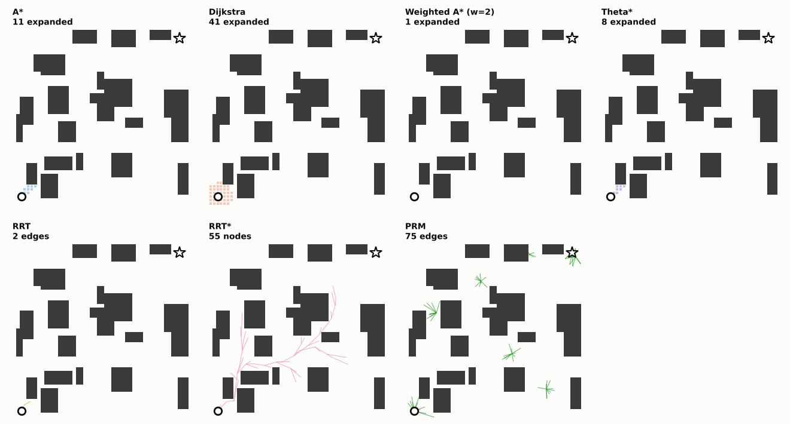
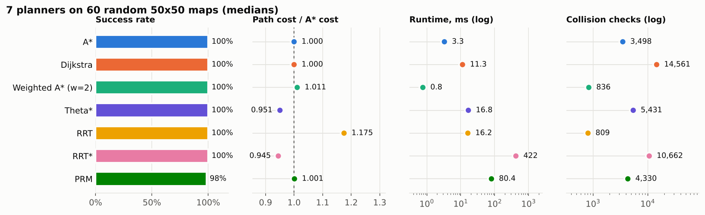
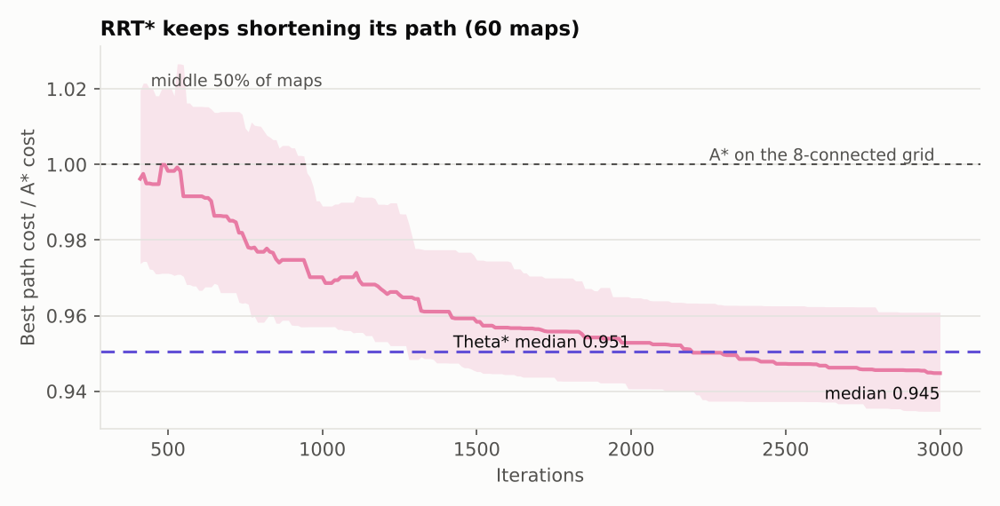
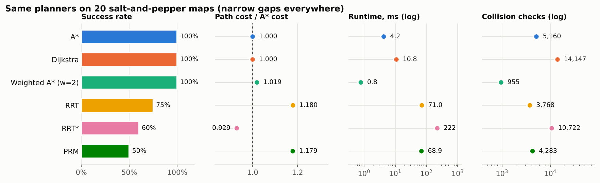

# PathPilot

[](https://github.com/siddhant-tandale/PathPilot/actions/workflows/ci.yml)

Six motion planners, written from scratch in Python, compared on the same seeded maps:
**A\***, **Dijkstra**, **weighted A\***, **RRT**, **RRT\***, and **PRM**.



Each panel shows one planner's search on the same 50x50 map. Grid planners show the cells they
expanded; sampling planners show their tree or roadmap. Panels are time-normalized so they finish
together; the titles show the real amount of work.

## Results

Benchmark: 60 random "blocks" maps (20 each at 15%, 25%, and 35% obstacle density), 50x50 cells.
Medians over maps. Path cost is relative to A* on the same map.



| Planner | Success | Path cost vs A* | Runtime (ms) | Collision checks | Nodes |
|---|---:|---:|---:|---:|---:|
| A* | 100% | 1.000 | 3.4 | 3,498 | 424 |
| Dijkstra | 100% | 1.000 | 11.4 | 14,561 | 1,850 |
| Weighted A* (w=2) | 100% | 1.011 | 0.7 | 836 | 72 |
| RRT | 100% | 1.175 | 14.3 | 809 | 204 |
| RRT* | 100% | 0.945 | 421.5 | 10,662 | 2,114 |
| PRM | 98% | 1.001 | 80.0 | 4,330 | 602 |

Per-density tables are in [`results/summary.md`](results/summary.md) and every individual run is in
[`results/benchmark.csv`](results/benchmark.csv).

### What the numbers show

- **The heuristic is worth about 4x.** A* and Dijkstra always return the same cost (both are
  optimal), but A* expands 424 nodes to Dijkstra's 1,850 because the octile heuristic points the
  search at the goal.
- **Weighted A\* trades a little optimality for a lot of speed.** With w=2 the path is only 1.1%
  longer in the median case, well inside the guaranteed 2x bound, and it expands about 6x fewer
  nodes than A*.
- **RRT\* beats "optimal" A\* by 5.5%.** A* is only optimal on the 8-connected grid graph, where
  every move is horizontal, vertical, or 45 degrees. RRT* plans in continuous space, so its paths
  can go at any angle. The price is time: about 120x slower than A* here.
- **RRT\* keeps improving after its first solution.** That is the asymptotic optimality property:
  rewiring keeps shortening the path as samples are added.

  

- **Plain RRT is fast to a first answer but its paths are 17.5% longer**, because every node
  connects to whichever tree node happened to be nearest, with no cost awareness.
- **PRM spends 97% of its time building the roadmap.** The query itself takes a couple of
  milliseconds. In a static environment where the roadmap is built once and reused, PRM is very
  cheap per query; this benchmark charges it the full build every time.

### Where sampling planners struggle

The same planners on 20 salt-and-pepper maps, where obstacles are scattered cell by cell and the
free space is full of 1-cell gaps:



Grid planners still succeed every time, but RRT drops to 75%, RRT* to 60%, and PRM to 50% within
their sample budgets. This is the **narrow passage problem**: uniform random samples almost never
land inside a gap that is one cell wide, so the tree or roadmap cannot get through it. Fixes from
the literature include bridge sampling, Gaussian sampling near obstacles, and planning on a coarser
or inflated map.

## Design decisions

- **Exact collision checking for segments.** Sampling planners check straight edges with grid
  traversal (Amanatides and Woo), visiting every cell the segment touches. Sampling points along
  a segment can step over a thin wall; traversal cannot. A property test compares it against
  dense sampling on random maps.
- **No corner cutting.** A diagonal move is only allowed if both orthogonal neighbors are free, and
  a segment passing exactly through a cell corner checks both cells that share it. Otherwise a robot
  could slip through a gap of zero width.
- **Comparable costs.** Every planner reports its path as continuous points (grid paths use cell
  centers), so all path lengths are measured the same way.
- **Reproducible.** Each map comes from a seed, and sampling planners use the map's seed, so
  `python -m pathpilot benchmark` regenerates the exact same table.
- **Fair maps.** "Blocks" maps are only accepted if a path exists with at least 1 cell of clearance
  (checked by inflating obstacles, the configuration-space idea). Without this, some maps were only
  solvable through a single-cell slot, which measures luck rather than planner quality. Noise maps
  skip this on purpose.
- **Counting collision checks.** Collision checking is usually the dominant cost in a real planner,
  so every query is counted. One caveat: a cell check and a segment check both count as one, even
  though a segment check does more work, so compare checks within a planner family.

## Usage

```bash
pip install -e .

# One planner on one map, saved as a figure
python -m pathpilot plan --planner rrt_star --seed 3 --density 0.3

# Full benchmark: writes results/ and docs/ figures (about a minute)
python -m pathpilot benchmark --maps 20

# The demo GIF
python -m pathpilot animate --seed 4
```

Planners: `astar`, `dijkstra`, `wastar`, `rrt`, `rrt_star`, `prm`. Map options: `--size`,
`--density`, `--style blocks|noise`, `--seed`.

From Python:

```python
from pathpilot import random_problem, run_planner
from pathpilot.planners import rrt_star

problem = random_problem(seed=3, density=0.3)
result = run_planner(rrt_star, problem, seed=3)
print(result.success, result.cost, result.runtime_s)
```

## Tests

```bash
pip install -e ".[dev]"
pytest
```

The suite checks that every planner returns a collision-free path, that A* matches Dijkstra's cost
while expanding no more nodes, that weighted A* stays within its bound, that RRT*'s best cost never
increases, and that every RRT* node's stored cost still matches its true path length after
rewiring (the easy-to-miss bug in RRT* implementations). CI runs lint, tests, and a CLI smoke test
on Python 3.10 and 3.12.

## Project layout

```
pathpilot/
  grid.py              occupancy grid, map generation, collision checking
  planners/
    grid_search.py     A*, weighted A*, Dijkstra (one best-first search, three priorities)
    rrt.py             RRT and RRT*
    prm.py             probabilistic roadmap
    base.py            shared PlanResult and timing wrapper
  benchmark.py         runs every planner on every map, writes CSV and tables
  viz.py               figures and the demo GIF
  cli.py               command-line entry point
tests/                 pytest suite
```

## Next steps

- Theta* (any-angle grid search), to separate "any-angle paths" from "sampling" in the RRT* result
- Path shortcutting for RRT and PRM output
- A k-d tree for nearest-neighbor queries, which are currently brute force
- Kinodynamic planning for a differential-drive robot instead of a point

## Background

PathPilot started as my individual project in ENGR 133 at Purdue (Fall 2025): A* on a random
occupancy grid. Version 0.2 rewrites it as a package and adds the other five planners, the
benchmark, and the test suite.

## References

- Hart, Nilsson, Raphael. A formal basis for the heuristic determination of minimum cost paths (1968)
- LaValle. Rapidly-exploring random trees: a new tool for path planning (1998)
- Karaman, Frazzoli. Sampling-based algorithms for optimal motion planning (2011)
- Kavraki, Svestka, Latombe, Overmars. Probabilistic roadmaps for path planning in high-dimensional
  configuration spaces (1996)
- Amanatides, Woo. A fast voxel traversal algorithm for ray tracing (1987)

## License

MIT
